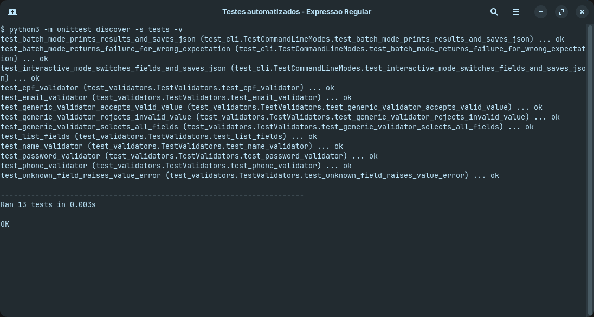
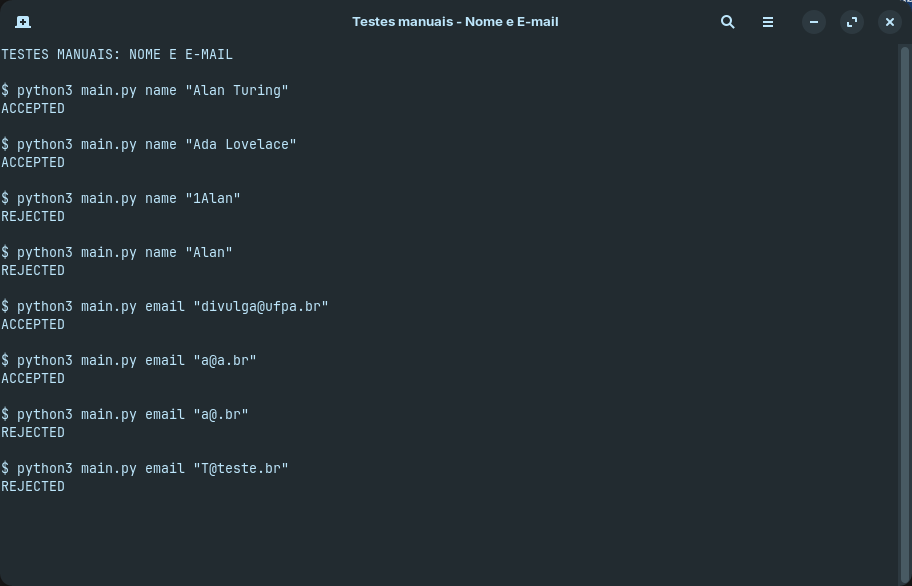
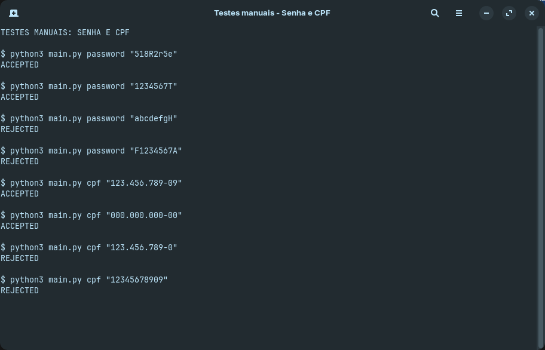
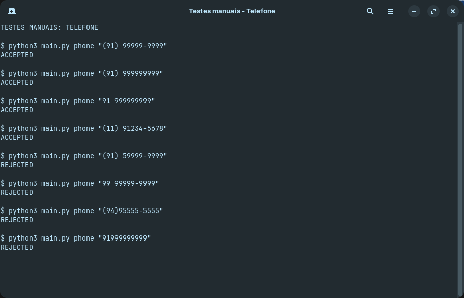

# Regular Expression Validator

Validador de nome, e-mail, senha, CPF e telefone usando expressões regulares.
Requer Python 3.12 ou superior e não usa dependências externas.

## Validar um valor

```bash
python3 main.py name "Alan Turing"
python3 main.py email "divulga@ufpa.br"
python3 main.py password "ropsSoq0"
python3 main.py cpf "123.456.789-09"
python3 main.py phone "(91) 99999-9999"
```

O terminal mostra `ACCEPTED` ou `REJECTED`.
Para salvar o resultado em um JSON:

```bash
python3 main.py cpf "123.456.789-09" --json result.json
```

## Testar vários casos

O arquivo `examples/test_cases.txt` contém 100 casos de teste para os cinco
campos, cada linha usa o formato `field;value;expected`.
Linhas iniciadas com `#` e linhas vazias são ignoradas, o resultado esperado pode ser `accepted` ou `rejected`.

```bash
python3 main.py batch examples/test_cases.txt --json results.json
```

O terminal mostra o resultado de cada linha e o resumo dos testes, o JSON
registra o campo, o valor, o resultado esperado e o resultado obtido.

Para adicionar casos, inclua linhas no arquivo, por exemplos:

```text
name;Alan Turing;accepted
email;T@teste.br;rejected
cpf;123.456.789-09;accepted
```

## Validar valores interativamente

```bash
python3 main.py interactive --json session_results.json
```

Digite o nome do campo para selecioná-lo, depois, digite os valores a serem validados.
Digite outro nome de campo para trocar a seleção e use `exit` para finalizar e
salvar os resultados no arquivo JSON.

```text
> cpf
cpf> 123.456.789-09
ACCEPTED
cpf> phone
phone> (91) 99999-9999
ACCEPTED
phone> exit
```

Campos disponíveis: `name`, `email`, `password`, `cpf` e `phone`.

## Executar os testes automatizados

```bash
python3 -m unittest discover -s tests -v
```

## Evidências dos testes

O script automatizado executou 13 testes sem falhas, as outras capturas mostram
as entradas manuais usadas no artigo, incluindo casos aceitos e rejeitados para
cada máscara.

### Script automatizado



### Nome e e-mail



### Senha e CPF



### Telefone



## Casos testados por campo

O teste em lote executou os 100 casos do arquivo `examples/test_cases.txt`.
Todos os resultados obtidos foram iguais aos resultados esperados: 100 casos
passaram e nenhum apresentou falha. Nas tabelas abaixo, `ACCEPTED` significa
que a entrada foi aceita pelo validador e `REJECTED` significa que ela foi
rejeitada conforme a regra do campo.

### Nome

| Entrada aceita | Obtido | Entrada rejeitada | Obtido |
|---|---|---|---|
| `Alan Turing` | `ACCEPTED` | `""` | `REJECTED` |
| `Noam Chomsky` | `ACCEPTED` | `1Alan Turing` | `REJECTED` |
| `Ada Lovelace` | `ACCEPTED` | `Alan` | `REJECTED` |
| `A B` | `ACCEPTED` | `alan Turing` | `REJECTED` |
| `Maria Silva` | `ACCEPTED` | `Alan turing` | `REJECTED` |
| `Joao Pessoa` | `ACCEPTED` | `Alan  Turing` | `REJECTED` |
| `John Smith` | `ACCEPTED` | `Alan Turing Silva` | `REJECTED` |
| `Z Z` | `ACCEPTED` | `João Silva` | `REJECTED` |
| `Aaaaa Bbbbb` | `ACCEPTED` | `Alan-Turing` | `REJECTED` |
| `Carlos Drummond` | `ACCEPTED` | `Alan1 Turing` | `REJECTED` |

### E-mail

| Entrada aceita | Obtido | Entrada rejeitada | Obtido |
|---|---|---|---|
| `a@a.br` | `ACCEPTED` | `""` | `REJECTED` |
| `divulga@ufpa.br` | `ACCEPTED` | `@` | `REJECTED` |
| `abc@xyz.br` | `ACCEPTED` | `a@.br` | `REJECTED` |
| `z@z.br` | `ACCEPTED` | `T@teste.br` | `REJECTED` |
| `nome@dominio.br` | `ACCEPTED` | `a@@teste.br` | `REJECTED` |
| `ana@teste.br` | `ACCEPTED` | `@teste.br` | `REJECTED` |
| `universidade@para.br` | `ACCEPTED` | `a@Teste.br` | `REJECTED` |
| `x@y.br` | `ACCEPTED` | `a.silva@teste.br` | `REJECTED` |
| `letras@exemplo.br` | `ACCEPTED` | `a@sub.teste.br` | `REJECTED` |
| `teste@dominio.br` | `ACCEPTED` | `usuario@servidor.com.br` | `REJECTED` |

### Senha

| Entrada aceita | Obtido | Entrada rejeitada | Obtido |
|---|---|---|---|
| `518R2r5e` | `ACCEPTED` | `""` | `REJECTED` |
| `F123456A` | `ACCEPTED` | `F1234567A` | `REJECTED` |
| `1234567T` | `ACCEPTED` | `abcdefgH` | `REJECTED` |
| `ropsSoq0` | `ACCEPTED` | `1234567HI` | `REJECTED` |
| `Abcdef1g` | `ACCEPTED` | `12345678` | `REJECTED` |
| `A1bcdefg` | `ACCEPTED` | `abcdefgh` | `REJECTED` |
| `0000000A` | `ACCEPTED` | `ABCDEFGH` | `REJECTED` |
| `zzzzzzZ9` | `ACCEPTED` | `Abc!1234` | `REJECTED` |
| `Xy123abc` | `ACCEPTED` | `Abc123` | `REJECTED` |
| `aB2cD3eF` | `ACCEPTED` | `ábcD1234` | `REJECTED` |

### CPF

| Entrada aceita | Obtido | Entrada rejeitada | Obtido |
|---|---|---|---|
| `123.456.789-09` | `ACCEPTED` | `""` | `REJECTED` |
| `000.000.000-00` | `ACCEPTED` | `123.456.789-0` | `REJECTED` |
| `999.999.999-99` | `ACCEPTED` | `111.111.11-11` | `REJECTED` |
| `001.002.003-04` | `ACCEPTED` | `12345678909` | `REJECTED` |
| `111.222.333-44` | `ACCEPTED` | `123-456-789.09` | `REJECTED` |
| `987.654.321-00` | `ACCEPTED` | `123.456.789.09` | `REJECTED` |
| `012.345.678-90` | `ACCEPTED` | `abc.def.ghi-jk` | `REJECTED` |
| `555.555.555-55` | `ACCEPTED` | `1234.567.890-12` | `REJECTED` |
| `100.200.300-40` | `ACCEPTED` | `123.456.789-012` | `REJECTED` |
| `010.010.010-10` | `ACCEPTED` | `123.456.789 09` | `REJECTED` |

### Telefone

| Entrada aceita | Obtido | Entrada rejeitada | Obtido |
|---|---|---|---|
| `(91) 99999-9999` | `ACCEPTED` | `""` | `REJECTED` |
| `(91) 999999999` | `ACCEPTED` | `(91) 59999-9999` | `REJECTED` |
| `91 999999999` | `ACCEPTED` | `99 99999-9999` | `REJECTED` |
| `(11) 91234-5678` | `ACCEPTED` | `(94)95555-5555` | `REJECTED` |
| `(21) 99876-5432` | `ACCEPTED` | `(91) 9999-9999` | `REJECTED` |
| `(31) 912345678` | `ACCEPTED` | `(091) 99999-9999` | `REJECTED` |
| `(41) 999999999` | `ACCEPTED` | `91 99999-9999` | `REJECTED` |
| `11 912345678` | `ACCEPTED` | `91999999999` | `REJECTED` |
| `21 998765432` | `ACCEPTED` | `(91) 99999 9999` | `REJECTED` |
| `61 987654321` | `ACCEPTED` | `(91) 99999999` | `REJECTED` |
